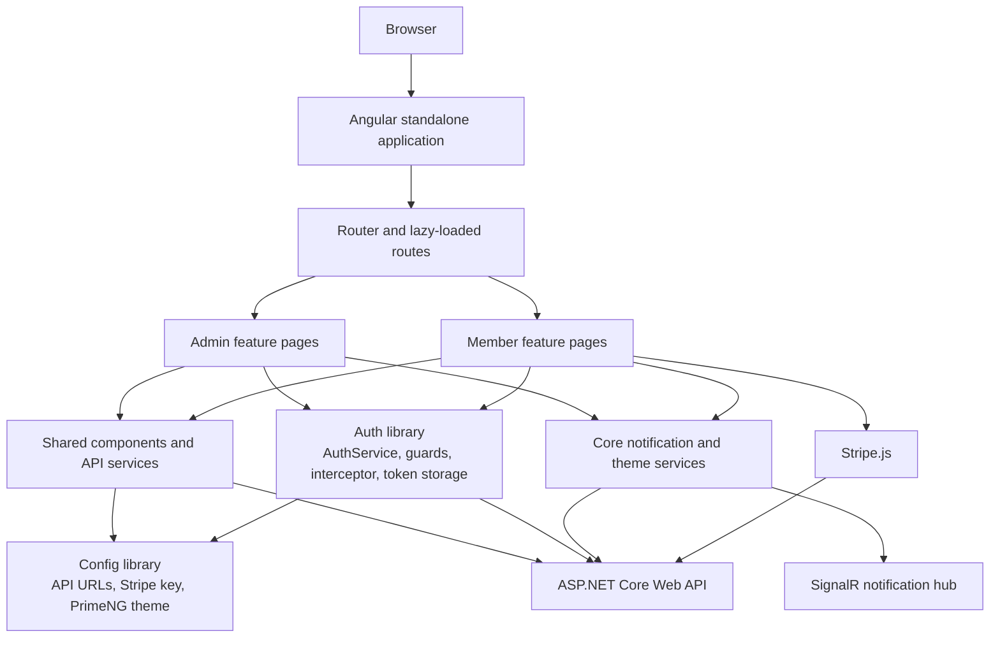

# Gym Management Frontend

An Angular client for a gym management system. The application provides separate Admin and Member experiences and communicates with an ASP.NET Core Web API through typed services, shared models, and centralized application configuration.

The frontend is organized as a standalone Angular application with reusable UI components, feature-focused pages, JWT-based authentication, protected routing, Stripe checkout, invoice viewing, and real-time notifications.

## Features

### Authentication and account access

- Login and logout flows
- Member registration with optional profile-image upload
- Email-confirmation resend flow
- Password reset request and password update screens
- JWT access-token and refresh-token handling
- Guest and authenticated route guards
- Role-aware Admin and Member navigation

### Admin workspace

- Dashboard metrics, revenue and attendance charts, and recent check-ins
- Member search, creation, editing, deletion, and active-member lookup
- Plans and subscription management
- Subscription activation, scheduling, cancellation, renewal, and freezing
- Payment history, payment details, cancellation, and administrative payment actions
- Promo-code and offer management
- Attendance history, filtering, sorting, and member check-in

### Member workspace

- Member dashboard and membership summary
- Plan browsing and membership selection
- Current membership and membership history
- Attendance history
- Payment history and payment details
- Stripe card checkout with PaymentIntent preparation
- Promo-code preview and discount calculation
- Payment-success flow and invoice access
- Profile, settings, and password-management screens

### Shared application capabilities

- Reusable payment details and invoice dialogs
- Invoice loading and PDF download
- Notification center with unread filtering and pagination
- Real-time notification delivery through SignalR
- Light/dark theme support with persisted preference
- Responsive Admin and Member layouts
- Loading, empty, validation, and API-error states throughout the UI

## Frontend Architecture

The project uses Angular standalone components and lazy-loaded routes. It does not use NgRx or another global state-management library. Page state is handled locally with Angular signals, while RxJS is used for HTTP streams, debounced searches, refresh-token coordination, and asynchronous workflows.

The main architectural boundaries are:

- **Application shell:** bootstrapping, global providers, router configuration, and PrimeNG configuration.
- **Core:** global infrastructure such as notifications, SignalR connectivity, theme state, and notification models.
- **Shared:** reusable UI components, shared domain models, image helpers, and API services used by more than one feature.
- **Features:** Admin and Member pages, feature-specific components, forms, and local presentation logic.
- **Auth library:** authentication service, token storage, interceptor, guards, roles, and authentication models.
- **Config library:** centralized API URLs, Stripe publishable-key configuration, and the PrimeNG theme preset.

Pages coordinate application actions and page-level state. Components render focused pieces of the UI and emit user actions. API communication is kept in services instead of templates or presentational components.

## Project Structure

```text
.
├── angular.json
├── package.json
├── tsconfig.json
├── projects/
│   ├── auth/                       # Authentication workspace library
│   │   └── src/lib/
│   │       ├── auth-service.ts
│   │       ├── auth-interceptor.ts
│   │       ├── guards/
│   │       ├── models/
│   │       └── token-storage.ts
│   ├── config/                     # Shared application configuration library
│   │   └── src/lib/
│   │       ├── config.ts
│   │       └── prime-theme.ts
│   └── gym/                        # Main Angular application
│       ├── public/                 # Static public assets
│       └── src/
│           ├── main.ts
│           ├── styles.scss
│           └── app/
│               ├── app.config.ts
│               ├── app.routes.ts
│               ├── admin/features/
│               ├── member/features/
│               ├── auth/pages/
│               ├── core/
│               │   ├── models/
│               │   └── services/
│               ├── layout/
│               └── shared/
│                   ├── components/
│                   ├── models/
│                   └── services/
└── dist/                           # Generated build output
```

The application routes Admin and Member areas through separate layouts. Feature pages are lazy-loaded with `loadComponent`, keeping initial application loading smaller and keeping feature code isolated.

## Tech Stack

| Area | Technology |
| --- | --- |
| Framework | Angular 22 standalone application |
| Language | TypeScript 6 |
| Reactive programming | RxJS 7.8 |
| UI components | PrimeNG 22 |
| Layout utilities | PrimeFlex 4 |
| Icons | PrimeIcons and `@primeicons/angular` |
| Charts | Chart.js 4 |
| Authentication | JWT with `jwt-decode` |
| Real-time communication | Microsoft SignalR client 10 |
| Payments | Stripe.js 7 |
| Testing | Angular unit-test builder with Vitest |
| Styling | SCSS and PrimeNG Aura theme |

## Authentication and Security

Authentication is implemented in the `auth` workspace library:

1. `AuthService` sends login credentials to the API.
2. Access and refresh tokens are stored by `TokenService` in browser local storage.
3. `authInterceptor` adds the access token as a Bearer header to outgoing requests.
4. A `401` response triggers one coordinated refresh-token request. Concurrent failed requests reuse that request and retry with the new access token.
5. Failed refresh or retry flows clear the stored session.
6. `authGuard` protects authenticated application areas, while `guestGuard` redirects authenticated users away from login and registration pages.

The application decodes JWT claims to identify the current role and user ID. Admin and Member layouts expose their respective navigation areas. The API remains responsible for authoritative authorization decisions.

No tokens, credentials, or private keys should be committed to the repository. Stripe configuration uses a publishable key only; secret Stripe credentials belong on the backend.

## Backend and API Integration

The client communicates with the ASP.NET Core API through injectable, typed services. The backend repository is not part of this repository. If it is published separately, link it here:

```text
https://github.com/YOUR_USERNAME/Gym-System
```

API services are organized by responsibility, including members, plans, subscriptions, payments, promo codes, invoices, attendance, dashboard data, and notifications. Shared services are reused by Admin and Member features where the API contract is common.

The base URL is defined once in `projects/config/src/lib/config.ts`:

```ts
const apiBaseUrl = 'https://localhost:xxxx';

export const appConfig = {
  apiBaseUrl,
  apiUrl: `${apiBaseUrl}/api/v1`,
  apiUrlV2: `${apiBaseUrl}/api/v2`,
  stripePublishableKey: 'pk_test_replace-with-your-publishable-key',
};
```

Services derive their endpoint URLs from this configuration. The SignalR notification hub also derives its URL from `apiBaseUrl`.

## Configuration

This project currently uses the workspace `config` library rather than Angular environment files. Before running the client, update the values in `projects/config/src/lib/config.ts` for the target environment:

- `apiBaseUrl`: the backend origin, without `/api/v1` or `/api/v2`
- `stripePublishableKey`: the Stripe publishable key for the environment
- `apiUrl` and `apiUrlV2`: derived API roots; normally these should remain derived from `apiBaseUrl`

Example local configuration:

```ts
const apiBaseUrl = 'https://localhost:7022';
```

Do not place Stripe secret keys, JWTs, refresh tokens, or other private credentials in this repository.

## Getting Started

### Prerequisites

- Node.js compatible with the Angular 22 toolchain
- npm 10.9.8 or a compatible npm 10 release
- A running instance of the ASP.NET Core backend API
- A Stripe publishable key if testing card checkout

### Install dependencies

```bash
npm ci
```

Use `npm install` when intentionally updating dependencies or regenerating the lockfile.

### Start the development server

```bash
npm start
```

Open [http://localhost:4200](http://localhost:4200). The development build uses source maps and reloads when source files change.

### Development build in watch mode

```bash
npm run watch
```

## Production Build

The default Angular build configuration is production-oriented:

```bash
npm run build
```

Build artifacts are written to:

```text
dist/gym/
```

The production configuration enables optimization, license extraction, output hashing, and bundle/component-style budgets.

For a development build:

```bash
npx ng build gym --configuration development
```

## Testing

The repository is configured with Angular's unit-test builder and Vitest. Run:

```bash
npm test
```

There are currently smoke tests for the Member Home page and the configuration library. The current generated configuration spec still references a removed `Config` export, so the full test command requires that stale spec to be updated before the suite is clean. There is no end-to-end test project configured in `angular.json`.

## Screenshots

No screenshots are currently committed to the repository. When adding a UI showcase, place optimized images under a directory such as:

```text
docs/screenshots/dashboard.png
docs/screenshots/member-payments.png
```

Then reference them here with normal Markdown image links.

## Architecture Diagram



## Example API Communication Flow

### Login and authorized requests

```text
Login page
  → AuthService.login()
  → ASP.NET Core identity endpoint
  → TokenService stores access and refresh tokens
  → authInterceptor adds the Bearer token to API requests
  → a 401 response triggers AuthService.refreshToken()
  → the original request is retried with the refreshed access token
```

### Real-time notifications

```text
Authenticated layout
  → NotificationCenterService.initialize()
  → NotificationSignalRService connects to the notifications hub
  → NotificationReceived event updates the notification state
  → NotificationCenter renders unread and all-notification views
```

### Stripe checkout

```text
Member checkout
  → PromoCodeService previews an optional promo code
  → PaymentService requests a Stripe PaymentIntent client secret
  → Stripe.js mounts a card element
  → confirmCardPayment() confirms the payment
  → successful payment emits the completion event and refreshes the UI
```

## Performance and UX

- Feature routes are lazy-loaded with standalone components.
- Search-heavy screens use debounced RxJS input streams.
- Local UI and loading state use signals and computed values where appropriate.
- API services use typed response models and shared endpoint construction.
- SignalR reconnects automatically using an incremental retry schedule.
- PrimeNG and PrimeFlex provide responsive UI primitives and consistent interaction patterns.
- Global SCSS defines shared typography, spacing, focus states, surfaces, and responsive dialog behavior.

## Future Improvements

- Replace the stale generated configuration spec and expand meaningful unit coverage for services, guards, and payment flows.
- Add end-to-end coverage for login, role navigation, subscription actions, and Stripe checkout boundaries.
- Add CI validation for formatting, type checking, production builds, and tests.
- Introduce environment-specific configuration generation so local, staging, and production values are selected without editing source files.
- Review token storage strategy and consider a deployment-specific approach that reduces exposure to browser script access.
- Continue extracting the largest feature pages into focused presentational components as new workflows are added.
- Add committed, optimized screenshots and a link to the deployed client when available.

## CI/CD

No GitHub Actions workflow or other CI/CD configuration is currently committed. A future pipeline should install dependencies with `npm ci`, run the unit-test command, perform a production build, and publish the contents of `dist/gym/` through the chosen hosting platform.

## Contributing

1. Create a feature branch from the default branch.
2. Keep changes scoped to the relevant feature or shared boundary.
3. Preserve existing API contracts and authentication behavior.
4. Run the production build and applicable tests locally.
5. Open a pull request with a concise summary, screenshots for UI changes, and validation notes.
